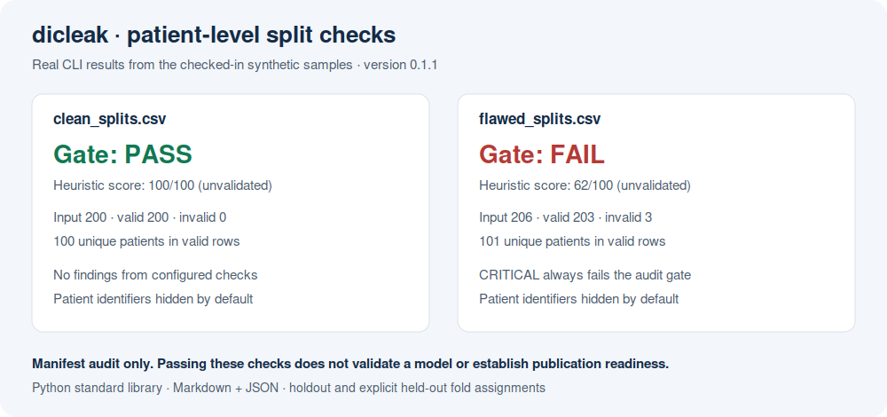

# dicleak：医学影像数据集划分检查

**训练前，用一条命令检查同一患者是否进入不同数据集。**

无需运行时依赖，读取 CSV manifest，输出终端、Markdown 和 JSON 报告。
适用于同一患者贡献多张影像、多次检查或多个病灶的研究。

[English](README.md) · [合成正常样例报告](docs/clean-audit.md) ·
[合成缺陷样例报告](docs/flawed-audit.md)



## 开始使用

已发布版本可通过 `python -m pip install dicleak` 安装。当前仓库代码为
**0.1.1**；在该版本发布到 PyPI 前，安装最新版功能请使用源码：

```bash
git clone https://github.com/chenmei24/dicleak.git
cd dicleak
python -m pip install .
dicleak samples/clean_splits.csv --report audit.md --json audit.json
```

正常样例含 200 行、100 名合成患者，结果为 `PASS`。

```bash
dicleak samples/flawed_splits.csv --report flawed-audit.md --json flawed-audit.json
```

缺陷样例包含患者跨分区、重复路径字符串、姓名模式标识和 3 行无效记录。
启发式分数为 62/100，但**任何 CRITICAL 都会使检查失败，退出码为 1**。
样例仅含合成记录，不含影像文件或真实患者资料。

## 输入格式

```csv
patient_id,split,label,filepath
SYN001,train,0,synthetic/image_001.dcm
SYN002,train,1,synthetic/image_002.dcm
SYN003,test,0,synthetic/image_003.dcm
SYN004,test,1,synthetic/image_004.dcm
```

`patient_id`、`split`、`label` 必填，`filepath` 可选。常用列名别名见
[英文说明](README.md#manifest-format)。表头大小写不敏感，空格与连字符转换为
下划线，支持 UTF-8 BOM。重复表头、同一字段的两个别名列会被拒绝。

字段两端空格被去除，患者标识与标签保留大小写。空值、未知分区、列数不一致
均作为错误保留行号并使检查失败；报告同时显示输入行数、有效行数、无效行数。
无效行不进入分布分析，不会静默当作正常记录处理。

## 划分模式

默认 `holdout` 必须存在 `train` 与 `test`，`val` 可选。支持 `training`、
`validation`、`testing` 等常用别名。只有训练集不能通过。

交叉验证使用显式指定的、互斥的**留出折分配**：

```bash
dicleak samples/cv_folds.csv --split-mode cv --folds fold1 fold2 fold3 --report cv-audit.md
```

每条观察只有一个留出折，每个患者只能属于一个折；指定的各折均须有有效记录。
折名区分大小写，`fold` 表头本身不会自动切换模式。此格式不是每轮 CV 重复列出
train/val 的长表；嵌套、重复交叉验证及独立外部测试请分别整理并结合研究设计审查。

## 标签与统计口径

默认 `--label-mode row` 允许同一患者不同病灶或时间点有不同标签。
报告同时给出影像行数和患者数。患者标签计数是“具有该标签的患者人数”：
同一患者有多个标签时，各标签都会计入，比例之和可能超过 100%。复合标签按原始
字符串处理，程序不解析多标签编码。

若任务要求每位患者仅有一个标签：

```bash
dicleak samples/clean_splits.csv --label-mode patient
```

默认分类检查会将单类别分区判为 CRITICAL。若任务有意只含一类，例如特定分割
任务，可明确关闭该检查：

```bash
dicleak samples/clean_splits.csv --allow-single-class
```

其他检查仍然启用；此参数不代表该任务的评价方案已充分。

## 结果如何使用

| 退出码 | 含义 |
|---|---|
| `0` | 无 CRITICAL 且启发式分数 ≥60 |
| `1` | 存在 CRITICAL 或启发式分数 <60 |
| `2` | 参数、文件结构、读取或报告写入错误 |

患者跨分区、输入错误、必需分区缺失等问题始终导致失败。分布差异超过 20 个
百分点、测试比例小于 10%、其他分区小于 5%、患者数少于 20/50 等，仅为便于
复核的经验阈值，不是经过临床或统计学验证的质量标准。**分数不表示可投稿、
模型可靠或已满足法规要求。**

## 报告与隐私

```bash
dicleak splits.csv --report audit.md --json audit.json
dicleak splits.csv --report private-audit.md --show-ids
```

默认不在报告中重新列出患者标识。`--show-ids` 可用于私下排查，最多列出部分
标识；标签、折名和自定义链接仍会显示，分享前需检查。程序不是脱敏验证工具。
姓名模式检查仅覆盖有限的拉丁字母模式，可能漏报和误报。

输入文件、Markdown 与 JSON 输出文件必须为不同路径，已存在的符号链接或硬链接
同样检查。指定的旧报告会被替换，但不能将输入文件作为报告目标。
原有 `--cta "https://your-service.example/audit"` 页脚参数保留，仅接受 HTTP(S) URL。

## 能检查什么

程序只检查 manifest，不读取 DICOM 头、像素或文件哈希。相同路径字符串不等于
确认内容重复，不同路径也可能指向同一影像。不同标识实际属于同一患者、中心或
设备混杂、模型效能和外部验证均不在此工具能力范围内。

## 开发与反馈

Python 3.9+，运行时仅用标准库。CI 覆盖 Linux/Windows、Python 3.9/3.11/3.13。

```bash
python -m pip install -e ".[dev]"
python -m pytest -q
python -m build
python samples/generate_samples.py
```

见 [贡献说明](CONTRIBUTING.md)、[更新日志](CHANGELOG.md) 与
[问题反馈](https://github.com/chenmei24/dicleak/issues)。反馈请使用合成示例，
不要提交真实患者资料。MIT 许可。

## Related tools / 相关工具

- [Manuscript rule checks](https://github.com/chenmei24/manulint)
- [Traceable clinical CSV QA](https://github.com/chenmei24/clinical-imaging-data-qa-demo)

[Launch tutorials and share images / 推广教程与展示图](docs/launch/README.md)
